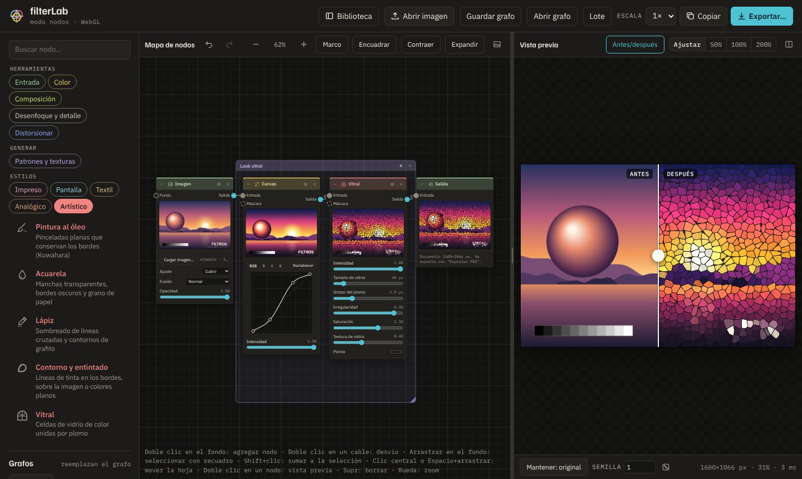

# filterLab

Efectos de impreso, pantalla, textil, analógico y distorsión para aplicar sobre tus propias imágenes, directo en el navegador. Está pensado para reemplazar las cadenas de pasos que en Photoshop llevan varios minutos: semitonos, riso, CRT, VHS, punto cruz, cianotipia, tramados y más.

Todo se procesa en la GPU con WebGL2. Las imágenes no se suben a ningún servidor.



## Dos versiones

| | Para qué |
|---|---|
| [`nodos/`](nodos/) | Editor de nodos al estilo de los programas de materiales: imágenes, mezclas, máscaras, patrones y texturas conectados en un grafo. |
| [`clasico/`](clasico/) | Una pila de filtros que se aplica de arriba hacia abajo. Más simple y rápido para looks de un solo paso. |

La raíz tiene un `index.html` que presenta las dos.

## Cómo usarlo

**Sin instalar nada:** abrí `nodos/index.html` o `clasico/index.html` con doble clic. Funciona sin conexión. Solo las tipografías y el compresor `.zip` del modo "Lote" se cargan de internet, y si no hay conexión se usan tipografías del sistema.

**Online:** [c0pete.github.io/filterlab](https://c0pete.github.io/filterlab/) (con GitHub Pages activado: *Settings → Pages*, rama `main`, carpeta `/ (root)`).

**Servidor local (opcional):**

```bash
python3 -m http.server 8000
# y abrí http://localhost:8000
```

## Qué trae

**Modo nodos** (la biblioteca está agrupada por función en un acordeón, con colores cian para herramientas, magenta para patrones y texturas, y amarillo para estilos)
- **Entrada:** Imagen (carga a tamaño original; se escala o mueve con Transformar y se combina con Mezclar), Texto (con fuentes de Google Fonts, degradado, contorno y texto en curva; con el nodo seleccionado se arrastra sobre la vista previa), Pintura (pincel, goma, lazo, balde y cuentagotas sobre la vista previa; sale como color o como máscara), Color, Degradado (lineal, radial o rombo; se edita sobre la vista previa: arrastrás los puntos, doble clic cambia el color y la barra de abajo ajusta la opacidad de cada punto) y Salida.
- **Ajustes:** Ajustes, Curvas (general y por canal), Mapa de degradado, Niveles, Tono y saturación, Invertir, Posterizar, Umbral, Mezclador de canales, Corrección selectiva y Reemplazar colores (posteriza y asigna colores desde una rueda con armonías).
- **Composición:** Opacidad, Mezclar (modo, opacidad y máscara; para mover o escalar el frente se usa Transformar), Máscara de luminancia, Separar y Unir canales y Desvío.
- **Efectos:** Sombra paralela, Resplandor exterior, Borde (marco plano o degradado), Detectar bordes, desenfoque gaussiano, de movimiento y radial, Brillo (bloom), Ruido, Nitidez y Viñeta.
- **Transformar:** Transformar (con remuestreo por aproximación, bilineal o alta calidad; si recibe directo una Imagen, muestrea la foto original), Recortar (fija el tamaño en px de lo que sigue, con formatos comunes, ajuste tamaño real / encajar / cubrir y anclaje; lo anterior no se ve afectado), remolino, coordenadas polares, esferizar, inflar, encoger, lente, fruncir, emborronar, ondas, onda senoidal, turbulencia, caleidoscopio, cizalla, espejo, mosaico repetido y desplazar con mapa.
- **Patrones** y **Texturas:** rayas, damero, lunares, grilla, ondas, zigzag, ladrillos, panal, rombos, círculos, triángulos, tartán, pata de gallo y espiga; ruido, nubes, celular, madera, mármol, papel, papel arrugado, lienzo, hormigón, cartón, grunge y polvo y rayas.
- **Estilos:** Impreso (semitonos, CMYK, riso, tramados, difusión de error, fotocopia, grabado), Pantalla (scanlines, CRT, aberración, glitch, VHS, píxel, LCD), Textil (punto cruz, tejido, bordado, serigrafía, punto), Analógico (grano, light leak, cianotipia, duotono, instantánea) y Artístico (óleo, acuarela, lápiz, contorno y entintado, vitral).
- Todos los filtros tienen entrada de máscara e intensidad, y el ojo de cada ficha apaga el efecto sin cortar la cadena.
- Atajos con la tecla ?, minimapa de la mesa, Alt + arrastrar para duplicar fichas.
- Marcos con título para agrupar nodos, desvíos para ordenar cables y vista antes/después con barra.

**Exportación:** cualquier nodo (no solo la Salida) en PNG, JPG, WebP, PSD con capas o SVG vectorial (semitono), a 1×–4× o a un ancho en píxeles, con transparencia tomada de otro nodo. El PNG guarda el grafo adentro: abrilo con "Abrir grafo" o arrastralo al mapa para recuperar los nodos. "Copiar" deja la imagen en el portapapeles para pegarla en Photoshop con Ctrl+V.

**Modo clásico:** la pila de filtros original (impreso, pantalla, textil, analógico, general y distorsionar), con presets, PNG a 1×–4× y lote a `.zip`.

## Biblioteca de configs

La pestaña **Biblioteca** (al lado de Mapa de nodos) muestra una tarjeta por config, con su miniatura, nombre y medida de salida. Al iniciar siempre está la Predeterminada. Cada .json, .png con grafo o .zip que abrís se suma como config nueva, sin pisar las demás. Las configs guardan el grafo y una miniatura, no las imágenes: al abrir una se usa la imagen que esté cargada en la mesa. El candado de cada tarjeta la bloquea como modelo base: se puede editar, pero los cambios no se guardan. **Guardar todo (.zip)** empaqueta todas las configs, cada una con su config.json y su miniatura.

## Atajos del modo nodos

| Acción | Cómo |
|---|---|
| Buscar y agregar nodo | Tocar Espacio sobre el mapa |
| Agregar nodo | Doble clic en el fondo, o soltar un cable en el vacío |
| Conectar | Arrastrar de un punto de salida a uno de entrada |
| Seleccionar varios | Shift+clic, o arrastrar un recuadro sobre el fondo |
| Mover la hoja | Clic central, o Espacio + arrastrar |
| Zoom | Rueda del mouse (en el mapa y en la vista previa) |
| Ver un nodo en la vista previa | Doble clic en su miniatura |
| Vista previa flotante | Botón de ventana en la barra de la vista previa |
| Agregar un desvío | Doble clic sobre un cable |
| Agrupar nodos | Seleccionarlos y tocar "Marco" |
| Apagar un efecto sin cortar la cadena | El ojo de la ficha |
| Ver la imagen original | Mantener la tecla O |
| Encuadrar todo | F |
| Duplicar / borrar | Ctrl+D / Supr |
| Deshacer / rehacer | Ctrl+Z / Ctrl+Shift+Z |
| Herramientas de pintura | B pincel · E goma · L lazo · G balde · I cuentagotas · [ ] tamaño · X blanco/negro · Esc terminar |

Los grafos se guardan como `.json` con "Guardar grafo". El `.json` guarda los nodos, sus valores y lo pintado, pero no las imágenes cargadas.

## Cómo está hecho

Cada versión es un solo archivo HTML, sin dependencias ni paso de compilación.

- Cada filtro es una función GLSL `fx(uv)` más una lista de parámetros. La interfaz se arma sola a partir de esa lista.
- El modo clásico encadena los filtros con tres texturas que se alternan.
- El modo nodos evalúa el grafo desde la Salida hacia atrás. Cada nodo escribe en una textura de un pool que se reutiliza, y se libera cuando ya nadie la necesita.
- Los tamaños en píxeles se expresan en píxeles de la imagen original, así la vista previa y el PNG exportado coinciden.
- La difusión de error corre en CPU, porque no se puede paralelizar bien en la GPU.

### Agregar un filtro

En el arreglo `FILTERS` de cualquiera de los dos archivos:

```js
{id:'mifiltro', cat:'general', name:'Mi filtro', desc:'Qué hace',
 params:[R('amt','Cantidad',0,1,.5,.01)],
 glsl:`vec4 fx(vec2 uv){ vec3 c=Tc(uv); return vec4(c*p_amt,1.); }`}
```

`R`, `C`, `S` y `B` crean controles de rango, color, lista y casilla. Cada parámetro llega al shader como `p_<clave>`.

## Requisitos

Un navegador con WebGL2: Chrome, Edge, Firefox o Safari en versiones recientes.

## Licencia

MIT. Ver [LICENSE](LICENSE).
